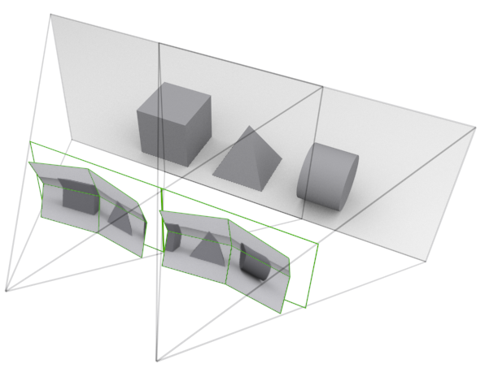
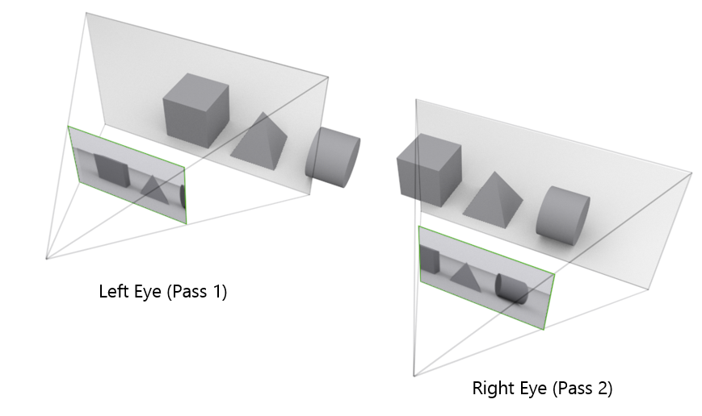

# Assignment

The main goal of this project was for my COIS-4480 assignment below are the parts of that assignment separate from the rendering itself, I also put together a list of how i'm fulfilling each requirement to make it a bit more clear as some of my abstractions abstract over the requirements.

## Theory

### Question 1: Modern graphics & GPU computing

GPU based computing is often implemented through compute shaders, as opposed to traditional vertex and fragment shaders. The primary difference is that vertex and fragment shaders are organized around the geometry and rendering pipeline of a scene, whereas compute shaders can be dispatched and organized in various ways depending on the developer's requirements. Programming on the GPU requires care and a good understanding of the hardware's strengths and limitations. Compared to CPUs, which excel at executing arbitrary sequential operations, individual GPU cores are generally simpler and more specialized. However, modern GPUs can contain thousands of these cores, allowing them to execute massively parallel workloads (Satish 1).

Just because a task can be parallelized, however, does not necessarily mean it will translate directly to the GPU. There are other limitations to consider. For instance, GPUs generally do not provide the same conventional dynamic heap allocation model that developers are accustomed to on CPUs. As a result, memory often needs to be allocated ahead of time, and even something like sorting a list of objects can require approaching the problem in a fundamentally different way (Satish 1).

The specific problem with transferring data back and forth between the CPU and GPU isn't necessarily the size of the data. When we're talking about something like a transformation matrix, the amount of data is relatively small by modern standards. Even a few hundred matrices represent a negligible amount of data. However, it's worth noting that GPUs often have less available memory than system RAM, so memory usage is still an important consideration. The larger issue is the overhead associated with transferring data and synchronizing the CPU and GPU to prevent race conditions. I wouldn't necessarily argue that transferring data back and forth is inherently bad. Rather, an operation that is mechanically faster on either the CPU or GPU doesn't necessarily translate to better overall performance once you account for the associated overhead, because inter device communication is expensive (Satish 3). Consequently, it makes sense to not only minimize unnecessary data transfers but also structure an application to communicate between the CPU and GPU at favourable points in its execution.

Modern hardware and software have attempted to address some of these limitations. For instance, unified memory architectures, such as those found in the PlayStation 5 and Apple Silicon, eliminate the need to explicitly copy data between separate physical memory pools. However, synchronization overhead still exists, and failing to properly coordinate access can still introduce race conditions. Another interesting development is compiler infrastructure such as MLIR, which provides abstractions for representing and transforming programs into more parallel forms (Lattner 11). Frameworks built on top of such infrastructure can help automate some of the decisions involved in parallelization and determining whether workloads should be offloaded to the GPU.

#### Citations

> Markdown has bad hanging indent support.

1 Designing Efficient Sorting Algorithms for Manycore Gpus Nadathur Satish,

&emsp; mgarland.org/files/papers/gpusort-ipdps09.pdf. Accessed 14 Nov. 2026.

MLIR: Scaling Compiler Infrastructure for Domain Specific Computation,

&emsp; storage.googleapis.com/gweb-research2023-media/pubtools/5945.pdf. Accessed 14 Nov. 2026.

### Question 2: Cameras for virtual reality

While researching this topic, I found three techniques that I thought were particularly interesting. The main thing all of these techniques have in common is that rather than just looking at the small overlap in between the eyes, they take advantage of the shared scene and rendering properties between the two viewpoints (most data is shared).

One of the most aggressive techniques I ended up coming across is called **Image Reprojection**. The simple premise is that rather than rendering the scene twice (once per eye), we can render it once for one eye and then derive the second image from the first (Kimball 1). The reason that this works is because when we render a frame we get both a simple colored image and a depth buffer. Instead of treating the result as a simple 2D image, we can interpret the depth buffer as a representation of the scene's 3D geometry and use it to reproject pixels from one viewpoint to another while reusing color information from the color buffer.

The main advantage of this optimization is that because we are no longer processing the entire a second time, the reprojection can be performed in time proportional to the size of the image rather than the complexity of the scene. This is particularly beneficial for more complex scenes where avoiding the repeated geometry and shading calculations outweighs the costs of relatively simple reprojection. However the main drawback of this approach is that because the second eye has a different position it can see information in the scene that may not be in the original image. The solution to this problem in the original paper was to leave these as reconstruction errors, however other techniques can be used to attempt to address this by reprocessing the small portions of the scene where information is missing.

The second approach I found is **Multiview Rendering**, this is a hardware supported technique developer by NVIDIA around 2019. When considering how much work goes into rendering a scene, much of it involves processing geometry and working in world space. These operations are generally independent of the viewpoint until we convert to clip space. This is where multiview rendering comes in. Rather than repeeating the entire shader pipeline for each viewpoint, we can share most of the geometry and calculations and apply seperate camera transformations for each eye (Bhonde).

Like the previous approach, this technique can be particularly effective in scenes with many objects, as it reduces the amount of repeated processing. Unlike image reprojection, overlapping geometry is not a concern because we preserve the underlying geometry and independently project it for each camera. The downside is that this approach requires hardware support and additional shader considerations to handle multiple views.

The third approach I found is also from NVIDIA and is called **Single Pass Stereo Rendering**. The basic premise is that a considerable amount of rendering overhead can come from submitting draw calls and transferring data to the GPU. With single pass stereo rendering, rather than submitting the same geometry and draw calls independently for each eye, we submit them once and instruct the GPU to render both viewpoints (Cebenoyan 33).

The benefit of this approach is that it is relatively straightforward and reduces CPU side submission overhead. However, unlike more aggressive techniques such as image reprojection and hardware-assisted multiview rendering, it does not necessarily eliminate duplicated GPU processing. The geometry still needs to be rendered from both viewpoints, and view-dependent shader operations must still be performed separately. As a result, its performance benefits are more dependent on how much of the rendering workload comes from draw-call and submission overhead.

#### Stereo Rendering

Here is an image from NIVIDA that shows how the process works.

Source: https://developer.nvidia.com/vrworks/graphics/singlepassstereo

#### Traditional Rendering

And here is how traditional rendering works for comparison

Source: https://developer.nvidia.com/vrworks/graphics/singlepassstereo

#### Citations

Cem Cebenoyan Edward Liu Daniel Price Accelerating Your VR Games with Vrworks 1,

&emsp; developer.download.nvidia.com/assets/gameworks/downloads/regular/GDC17/VRWorks_GDC17_FINAL.pdf. Accessed 14 Nov. 2026.

Kimball, J., et al. “Dynamic IBR techniques for fixed cost stereoscopic support.”

&emsp; IEEE Virtual Reality Conference (VR 2006), pp. 297–300, https://doi.org/10.1109/vr.2006.54.

“Turing Multi-View Rendering in VRWorks.” NVIDIA Technical Blog, 21 Aug. 2022, developer.nvidia.com/blog/?p=12041.

## Programming Requirements

- [x] Define your scene using a tree structure.
  - This is achieved by `../src/engine/prototypes/gameObject.ts`
- [x] Update and render your scene by traversing the tree; drawing a node in the tree should also draw all of its children.
  - This is achieved by `../src/engine/renderer.ts`
- [x] Grouped/nested objects should move together; (e.g., a character model's hands would move along with their arms, which would move along with their torso, and so on. )
  - This is achieved by the combined operations in `../src/engine/renderer.ts`, `../src/engine/prototypes/gameObject.ts` & `../src/engine/prototypes/renderableGameObject.ts`
- [x] Have at least one “grandchild” in your scene: an object whose overall position is based on two or more ancestors.
  - I have many but a simple one is the `playerFlashlight` in `../src/main.ts`
- [x] Have at least one set of “siblings” in your scene graph: two or more objects with the same parent, but whose transformations do not affect each other. Worded another way, have at least one node in your scene graph with more than one child node.
  - I have this in a few places but one of the main ones is `World` in `../src/engine/primitives/world.ts`
- [x] Have at least one node in your scene graph with three or more children attached to it.
  - I have this in a few places but one of the main ones is `World` in `../src/engine/primitives/world.ts`
  - You can also check the `Player` in `../src/objects/player.ts`
- [x] Make cameras into their own sub-class of your base scene object class.
  - This is achieved in `../src/engine/primitives/camera.ts`
  - Camera extraction is done in the `Renderer` in `../src/engine/renderer.ts`
- [x] Have at least two cameras in your scene graph. One of them must be a child of some other object in the scene graph so it stays attached as the object moves around.
  - I have multiple cameras they can be found in `../src/main.ts`
  - I have a nested camera in `../src/objects/player.ts`
  - This is also technically achieved by the world.
- [x] Cameras should have properties for field of view, near clipping plane distance, far clipping plane distance, and aspect ratio.
  - This is implemented in `../src/engine/primitives/camera.ts`
- [x] Cameras should have methods or getters that return their view and projection matrices.
  - I've done this a bit differently then stated but it achieves the same goals, the `inverse` of the model matrix is used for the `viewMatrix` in the `Renderer` and we compute the perspective matrix in the `Camera` itself.
- [x] Use a button or dropdown to switch between the cameras in your scene (of which there should be at least two; see above).
  - This is implemented in `../src/main.ts` near the bottom
- [x] Allow for one of your cameras to be positioned and oriented in the scene using xx, yy, and zz sliders.
  - This is implemented in `../src/main.ts` as a behavior, the behavior itself is in `../src/behaviors/sliderBehavior.ts`
- [x] Allow for some of your objects to be transformed using sliders or other inputs. Make sure to cover all three dimensions of position, rotation, and scale between all your controllable objects.
  - I set this up in `../src/main.ts`, however the actual behavior is composed with `../src/behavior/selectionBehavior.ts` and `../src/behavior/sliderBehavior.ts`
- [x] Ensure that at least one of your controllable objects has a child, to show that its transformation affects all of its children.
  - I set this up in `../src/main.ts`
- [x] Draw/position your objects by passing model, view, and projection matrices to the shader (as opposed to generating them in the shader from individual properties).
  - I pre-multiply the view and projection matrices in the renderer for less data passing.
  - The model matrix is computed in `../src/engine/prototypes/gameObject.ts`
- [x] Like the first assignment, you should take advantage of composition, inheritance, or some other abstraction to simplify your code and avoid repetition.
- [x] Also like the first assignment, you should keep your code organized by making use of JavaScript/TypeScript modules (separate files with imports and exports in them).
